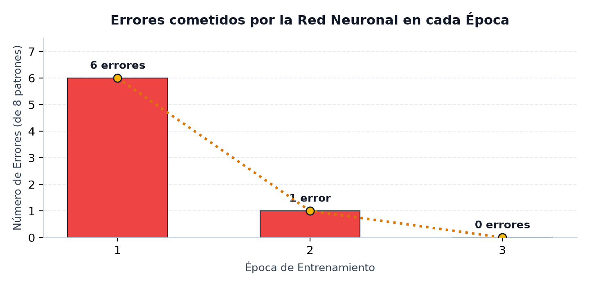
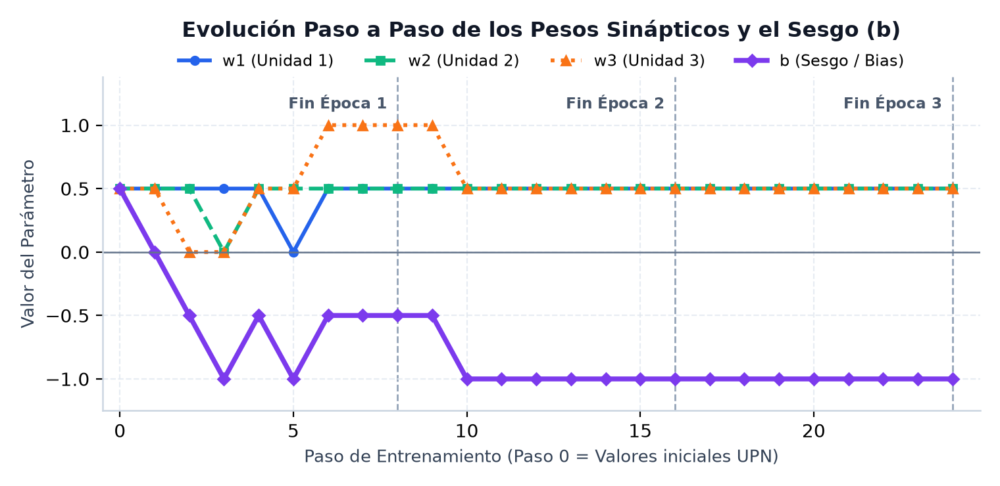
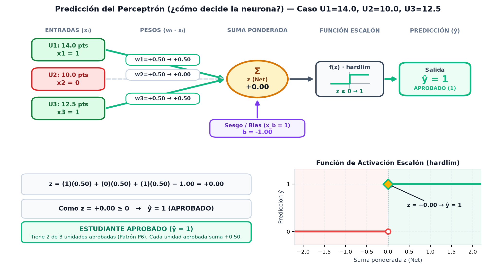
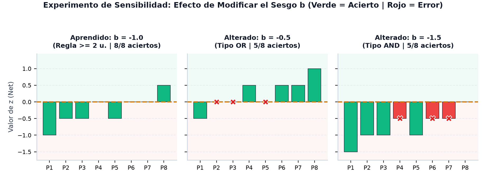

# UNIVERSIDAD PRIVADA DEL NORTE (UPN)
### FACULTAD DE INGENIERÍA
**Carrera Profesional de Ingeniería de Sistemas Computacionales**

---

## INFORME TÉCNICO – SESIÓN 14
# Entrenamiento de Red Neuronal Artificial (Perceptrón) para Evaluación de Aprobación Estudiantil

---

| Campo | Detalle |
| :--- | :--- |
| **Institución:** | Universidad Privada del Norte (UPN) |
| **Curso:** | Sistemas Inteligentes |
| **Docente:** | Marcelino Torres Villanueva |
| **Estudiante:** | Marco Antonio Gamez Monzon |
| **Código de Estudiante:** | N00324879 |
| **Ciclo:** | 10mo ciclo |
| **Fecha:** | Noviembre de 2026 |
| **Tecnologías:** | Python, Streamlit, NumPy, Pandas, Plotly / Altair |

---

## 1. Especificación de Reglas de Negocio y Preprocesamiento

El ejercicio propuesto en la Sesión 14 exige entrenar una Red Neuronal Artificial (**Perceptrón Simple**) para determinar si un estudiante aprueba o no una experiencia curricular cumpliendo estrictamente **4 indicadores**:

- **a.** Se deben considerar **3 promedios** (correspondientes a 3 unidades académicas: $P_1, P_2, P_3$).
- **b.** El estudiante debe tener **por lo menos 2 unidades aprobadas** para aprobar la experiencia curricular.
- **c.** Para el resultado final **no se considera ningún cálculo matemático** (no se promedian aritméticamente las notas); solo se aplica la regla del punto *b*.
- **d.** Los promedios por cada unidad deben estar comprendidos en el rango de **0 a 20**.

### 1.1 Criterio de Binarización

Considerando la nota mínima aprobatoria universitaria estándar de $11$, se aplica una transformación discreta previa a la entrada del Perceptrón para mapear cada promedio continuo $P_i \in [0, 20]$ a una variable binaria $x_i \in \{0, 1\}$:

$$x_i = \begin{cases} 1 & \text{si } P_i \ge 11 \quad (\text{Unidad Aprobada}) \\ 0 & \text{si } P_i < 11 \quad (\text{Unidad Desaprobada}) \end{cases}$$

De esta manera, la red neuronal nunca opera sobre el promedio aritmético de las notas; únicamente evalúa el vector binario $(x_1, x_2, x_3)$ y aprende la regla de mayoría:

$$Y_d = 1 \iff x_1 + x_2 + x_3 \ge 2$$

---

## 2. Matriz de Patrones de Entrenamiento (Tabla de Verdad)

Con $n = 3$ entradas binarias, el espacio completo de estados consta de $2^3 = 8$ patrones de entrenamiento:

| Patrón | $x_1$ (U1) | $x_2$ (U2) | $x_3$ (U3) | Unidades Aprobadas | Salida Deseada ($Y_d$) | Estado Esperado |
| :---: | :---: | :---: | :---: | :---: | :---: | :---: |
| **P1** | 0 | 0 | 0 | 0 | 0 | Desaprobado |
| **P2** | 0 | 0 | 1 | 1 | 0 | Desaprobado |
| **P3** | 0 | 1 | 0 | 1 | 0 | Desaprobado |
| **P4** | 0 | 1 | 1 | 2 | 1 | Aprobado |
| **P5** | 1 | 0 | 0 | 1 | 0 | Desaprobado |
| **P6** | 1 | 0 | 1 | 2 | 1 | Aprobado |
| **P7** | 1 | 1 | 0 | 2 | 1 | Aprobado |
| **P8** | 1 | 1 | 1 | 3 | 1 | Aprobado |

---

## 3. Algoritmo de Entrenamiento (Regla Delta Generalizada)

El Perceptrón monocapa se entrena recorriendo secuencialmente los 8 patrones por época mediante las siguientes ecuaciones (donde $Net$ equivale a $z$, $w_b$ a $b$, $fa$ a $\eta$, $Y_d$ a $y$ y la predicción a $\hat{y}$):

1. **Suma ponderada ($Net$ / $z$):**
   $$z = x_1 w_1 + x_2 w_2 + x_3 w_3 + 1 \cdot b$$
2. **Función de activación escalón (`hardlim`):**
   $$\hat{y} = f(z) = \begin{cases} 1 & \text{si } z \ge 0 \\ 0 & \text{si } z < 0 \end{cases}$$
3. **Cálculo del error:**
   $$e = Y_d - \hat{y}$$
4. **Actualización de pesos sinápticos y sesgo (solo si $e \neq 0$):**
   $$w_i(t+1) = w_i(t) + fa \cdot e \cdot x_i$$
   $$b(t+1) = b(t) + fa \cdot e \cdot 1$$

Cuando una época completa recorre los 8 patrones obteniendo $e = 0$ en todos los casos, el algoritmo alcanza la **convergencia** y finaliza.

---

## 4. Ejecución del Entrenamiento, Convergencia y Predicción

Siguiendo la metodología de la Sesión 14 (UPN), se inicializan los parámetros con:

- Pesos iniciales: $w_1 = 0.5$, $w_2 = 0.5$, $w_3 = 0.5$
- Sesgo inicial (*bias*): $b = 0.5$
- Factor de aprendizaje: $fa = 0.5$

### 4.1 Resumen de Épocas (3 épocas × 8 patrones = 24 evaluaciones)

- **Época 1 (Pasos 1–8 · 6 errores):** Corrige pesos en **P1** ($e=-1$), **P2** ($e=-1$), **P3** ($e=-1$), **P4** ($e=+1$), **P5** ($e=-1$) y **P6** ($e=+1$); **P7** y **P8** ya aciertan. Cierra con $w = (0.50, 0.50, 1.00)$ y $b = -0.50$.
- **Época 2 (Pasos 9–16 · 1 error):** Únicamente falla **P2** $(0, 0, 1 \to Y_d = 0)$ en la evaluación 10 de 24 ($z = +0.50 \implies \hat{y} = 1$, $e = -1$). El ajuste fija $w_3 = 0.50$ y $b = -1.00$; los demás patrones ya aciertan.
- **Época 3 (Pasos 17–24 · 0 errores):** Se verifican los 8 patrones obteniendo $e = 0$ en todos los casos (100 % de precisión), completando **$3 \times 8 = 24$ evaluaciones** y finalizando el entrenamiento.

| Época | Errores | Aciertos | Precisión (%) | $w_1$ final | $w_2$ final | $w_3$ final | Sesgo final ($b$) |
| :---: | :---: | :---: | :---: | :---: | :---: | :---: | :---: |
| **1** | 6 | 2 / 8 | 25.0 % | 0.50 | 0.50 | 1.00 | -0.50 |
| **2** | 1 | 7 / 8 | 87.5 % | 0.50 | 0.50 | 0.50 | -1.00 |
| **3** | **0** | **8 / 8** | **100.0 %** | **0.50** | **0.50** | **0.50** | **-1.00** |

### 4.2 Modelo Matemático Aprendido y Verificación Final

Los parámetros convergidos son $w_1 = 0.50$, $w_2 = 0.50$, $w_3 = 0.50$ y $b = -1.00$, definiendo el modelo final:

$$z = 0.50x_1 + 0.50x_2 + 0.50x_3 - 1.00$$

Su interpretación práctica es directa: cada unidad aprobada aporta **$+0.50$ puntos** y el sesgo **$-1.00$** actúa como requisito mínimo. Con 0 o 1 unidad aprobada la suma resulta negativa ($-1.00$ o $-0.50 \implies \hat{y} = 0$), mientras que con 2 o 3 unidades aprobadas alcanza $0.00$ o $+0.50 \implies \hat{y} = 1$.

| Patrón | Entrada $(x_1, x_2, x_3)$ | Suma Ponderada ($z$) | Predicción $\hat{y}$ | Esperado $Y_d$ | Error | Dictamen |
| :---: | :---: | :---: | :---: | :---: | :---: | :---: |
| **P1** | $(0, 0, 0)$ | $-1.00$ | 0 | 0 | 0 | Desaprobado |
| **P2** | $(0, 0, 1)$ | $-0.50$ | 0 | 0 | 0 | Desaprobado |
| **P3** | $(0, 1, 0)$ | $-0.50$ | 0 | 0 | 0 | Desaprobado |
| **P4** | $(0, 1, 1)$ | $0.00$ | 1 | 1 | 0 | Aprobado |
| **P5** | $(1, 0, 0)$ | $-0.50$ | 0 | 0 | 0 | Desaprobado |
| **P6** | $(1, 0, 1)$ | $0.00$ | 1 | 1 | 0 | Aprobado |
| **P7** | $(1, 1, 0)$ | $0.00$ | 1 | 1 | 0 | Aprobado |
| **P8** | $(1, 1, 1)$ | $+0.50$ | 1 | 1 | 0 | Aprobado |

### 4.3 Predicción del Perceptrón (¿cómo decide la neurona?)

Una vez convergidos los pesos, la inferencia para un estudiante concreto (por ejemplo: $U_1 = 14.0$, $U_2 = 10.0$, $U_3 = 12.5$) sigue el flujo ilustrado en la **Figura 3**:

1. **Binarización de entradas:** $U_1 \ge 11 \to x_1 = 1$, $U_2 < 11 \to x_2 = 0$, $U_3 \ge 11 \to x_3 = 1$.
2. **Suma ponderada con sesgo:** $z = (1)(0.50) + (0)(0.50) + (1)(0.50) - 1.00 = 0.00$.
3. **Función escalón (`hardlim`):** Como $z = 0.00 \ge 0$, la neurona dispara $\hat{y} = 1$ (**ESTUDIANTE APROBADO**).

### 4.4 Experimento de Sensibilidad sobre el Sesgo ($b$)

Para comprobar el papel determinante del sesgo en la clasificación final, se evaluaron variaciones controladas manteniendo fijos $w_1 = w_2 = w_3 = 0.50$:

| Configuración probada | Comportamiento lógico resultante | Aciertos | Errores | Casos fallidos |
| :--- | :--- | :---: | :---: | :--- |
| **$b = -1.0$ (Aprendido)** | **Mayoría ($\ge 2$ unidades aprobadas)** | **8 / 8** | **0** | Ninguno |
| $b = -0.5$ | Compuerta OR ($\ge 1$ unidad aprobada) | 5 / 8 | 3 | P2, P3, P5 |
| $b = -1.5$ | Compuerta AND (exige las 3 unidades) | 5 / 8 | 3 | P4, P6, P7 |
| $b = 0.0$ | Aprueba incluso con 0 unidades | 4 / 8 | 4 | P1, P2, P3, P5 |

---

## 5. Validación de los 4 Indicadores del Ejercicio

| Indicador | Mecanismo de cumplimiento | Caso de validación |
| :--- | :--- | :--- |
| **a. 3 promedios (3 unidades)** | El modelo recibe exactamente 3 variables de entrada $(P_1, P_2, P_3) \to (x_1, x_2, x_3)$. | Diagrama de 3 entradas y tabla de $2^3 = 8$ patrones. |
| **b. Mínimo 2 unidades aprobadas** | Salida deseada $Y_d = 1$ únicamente cuando $\sum x_i \ge 2$. | Verificación 8/8 con error $0$ en la tabla final. |
| **c. Sin cálculo matemático de promedio final** | La binarización previa descarta la magnitud numérica exacta antes de la inferencia. | **Caso 1:** `(11, 11, 0)` tiene promedio `7.33`, pero la RNA dictamina **APROBADO** (`2` unidades $\ge 11$). **Caso 2:** `(20, 10.5, 10.5)` tiene promedio `13.67`, pero la RNA dictamina **DESAPROBADO** (`1` unidad $\ge 11$). |
| **d. Rango de 0 a 20 por unidad** | Controles deslizantes limitados estrictamente a $[0.0,\; 20.0]$. | Imposible ingresar notas fuera del rango permitido. |

---

## 6. Arquitectura del Simulador Interactivo en Streamlit

La solución fue implementada en Python bajo una arquitectura modular de tres archivos desplegada en GitHub y lista para Streamlit Community Cloud:

- **`perceptron.py` (Capa de Modelo):** Encapsula `PerceptronRNA`, `binarize_grades()`, el registro completo de las 24 evaluaciones y `evaluate_manual_parameters()` para los experimentos de sensibilidad.
- **`visualizations.py` (Capa de Visualización):** Genera el diagrama SVG dinámico de la neurona en tiempo real y los gráficos interactivos con Plotly (errores por época, evolución de pesos, función escalón `hardlim` y experimento de sensibilidad).
- **`app.py` (Capa de Interfaz Web):** Organiza la aplicación en 4 pestañas: (1) Simulador en vivo + verificación de los 4 indicadores, (2) Entrenamiento paso a paso por Época y Patrón + descarga CSV, (3) Modelo aprendido y experimento interactivo con el sesgo, y (4) Resumen teórico.

---

## 7. Conclusiones

1. **Convergencia exacta del Perceptrón Monocapa:** La regla de aprobación por mayoría ($\ge 2$ de 3 unidades) es linealmente separable, permitiendo alcanzar **100 % de precisión en 3 épocas (24 evaluaciones)** con $w = (0.50, 0.50, 0.50)$ y $b = -1.00$.
2. **Cumplimiento riguroso de las reglas de negocio:** La binarización previa ($P_i \ge 11$) asegura que el sistema evalúe únicamente la cantidad de unidades aprobadas y no el promedio aritmético, comprobado con los contraejemplos `(11, 11, 0)` y `(20, 10.5, 10.5)`.
3. **Rol determinante del sesgo (*bias*):** Alterar $b = -1.00$ hacia $-0.50$ o $-1.50$ desplaza la frontera $z = 0$ y produce 3 errores al convertir la neurona en compuertas `OR` o `AND`.
4. **Claridad pedagógica del simulador web:** Integrar el diagrama dinámico de decisión de la neurona, la función escalón y el recorrido por época/patrón permite visualizar y sustentar con claridad cada etapa del ejercicio.
